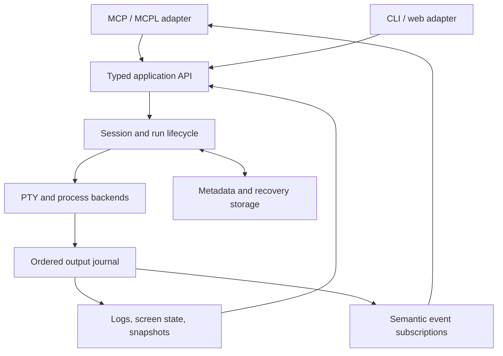

# Codex assessment and design sketch (draft 1)

*Verbatim, as relayed by Aster on 2026-09-16, written independently of `draft-1-claude.md`, except that links to files on the author's machine are given as repository paths. Kept for provenance; the integrated design is `DESIGN.md`.*

---

My subjective take: **this is a useful first-generation tool whose underlying model has become too small for its responsibilities.** It has the right central intuition—a terminal should remain available across agent turns, support real interaction, and be shared with humans—but much of its behavior is implemented through conventions and timing assumptions.

I would support a substantial rebuild. I'd make its organizing idea **a persistent execution environment with reliable observation and control**, with MCP/MCPL exposing that environment.

I read the runtime, transports, MCP bridge, CLI, GUI, tests, and the sibling MCPL specification and core library. I also ran the existing tests and several isolated PTY experiments.

The part I would preserve is the daemon/client separation. Keeping terminal ownership outside an individual agent connection is fundamentally sound, and your deployment documentation (`connectome-host/docs/DEPLOYMENTS.md`) already builds around that arrangement. Real PTYs, human access through xterm, interactive input, and named sessions are also good product decisions.

The implementation is relatively small—about 4,500 lines including the GUI and tests—so a coherent replacement is realistic.

**The deepest problem is that the code does not adequately distinguish a shell, a command, a service, and a request waiting for a result.**

They largely collapse into one mutable session object. That object owns the PTY, output buffers, command queue, completion detection, service readiness, logging, screenshots, and some process shutdown behavior. The 937-line session implementation (`src/server/session-server-v3.ts`) is where most of the product's assumptions meet.

Three experiments made the consequences concrete:

| Experiment | Observed behavior |
|---|---|
| Time out one command, with another queued behind it | The second command was reported successful using the first command's completion marker, before its own output appeared. |
| Launch `false` as a service | Reported `running`, because the enclosing shell remained alive. |
| Print text resembling the completion marker | The printed marker determined the reported exit code before the command finished. |

These follow directly from queue advancement and timeout handling (`src/server/session-server-v3.ts`), completion detection (`src/server/session-server-v3.ts`), and service monitoring (`src/server/session-server-v3.ts`).

That matters especially for capable agents. An agent can recover from an explicit "still running" or "execution state unknown." A confident but incorrect "finished successfully" can corrupt its entire subsequent plan.

There is a similar ambiguity around observation. The project has raw chunks, reconstructed log lines, cleaned text, and browser terminal state, but no authoritative model tying them together. Reconnection replays modified lines; the GUI loads history and then subscribes, leaving a gap; screenshots launch a browser and click through the GUI. Opening that screenshot view also follows the GUI's normal path for resizing the live PTY. An observation can therefore change what it is observing. See the screenshot implementation (`src/server/session-server-v3.ts`) and GUI initialization (`gui/public/app.js`).

Around those central issues, I see ordinary signs of incremental growth: two WebSocket clients with different behavior, duplicated contracts, extensive `any` at boundaries, an MCP-specific wrapper carrying application logic, and documentation that has drifted from implementation. Those are repairable, but reorganizing files alone would leave the deeper problems intact.

I would build the replacement around this shape:

These can be modules in one TypeScript project. The boundaries matter more than the package count.

1. **Give work its own identity and lifecycle.**

   A `Session` is a persistent environment. A `Run` is a particular execution. A `Service` adds readiness and health expectations to a run. An `Attachment` represents a human or agent observing or controlling a terminal.

   Starting work should return a `runId`. Waiting, reading output, cancelling, and reconnecting should refer to that identity. A caller's waiting deadline must not advance the execution queue or invent an exit status.

   This enables a basic but powerful workflow: start a build, work elsewhere, reconnect, and recover its actual outcome.

2. **Make execution guarantees explicit.**

   I would support distinct contracts for ordinary process execution, commands in a managed persistent shell, and raw terminal interaction.

   Ordinary processes can have directly observed exit status and separate stdout/stderr. Persistent shell commands need deliberate shell integration and execution correlation. Raw TUI interaction should expose input and screen state without pretending every interaction is a shell command.

   Shell integration has established precedent: VS Code explicitly tracks execution boundaries, exit status, and working directory. It is worth studying that design, while recognizing that terminal-emitted metadata is not itself an isolation boundary. [VS Code's shell integration documentation](https://code.visualstudio.com/docs/terminal/shell-integration#_supported-escape-sequences).

3. **Make output a dependable substrate.**

   Record ordered output with stable cursors, timestamps, session/run association where known, and explicit retention limits. Derive readable logs and terminal screen state from that stream.

   An attachment should receive a snapshot at cursor N followed by events after N. A slow consumer needs bounded buffering and an explicit recovery path. Truncation should be visible.

   I would evaluate a server-side xterm model, with screenshots rendered from a fixed snapshot. xterm provides a headless implementation and serialization facilities; its documentation also addresses flow control directly. [xterm project](https://github.com/xtermjs/xterm.js), [flow-control guidance](https://xtermjs.org/docs/guides/flowcontrol/).

   This also gives agents better observations: "output since my last read," "current screen," "this run's result," and "matching evidence with surrounding context."

4. **Design collaboration into control.**

   Several observers are straightforward. Several simultaneous writers require a policy.

   Make the current controller visible, support explicit handoff, and define who controls terminal dimensions. Record which actor submitted an operation. Separate observing, typing, executing, signalling, and destroying.

   Today the shared token essentially admits clients to the same authority. Future session permissions should be enforced in the application layer for every adapter. Any required filesystem or process isolation must additionally exist at the OS/container boundary.

5. **Define persistence precisely.**

   There are three different promises: surviving an agent disconnect, retaining history across daemon restart, and keeping live processes running across daemon restart.

   The current design provides the first. I would add durable metadata and output history early. If live process survival during upgrades is a requirement, place PTY ownership behind a separately supervised worker or evaluate a multiplexer backend.

   A database cannot restore a running shell's memory. Recovery should report accurately which work survived, exited, or became unobservable.

6. **Use one validated contract across interfaces.**

   Define operation schemas, results, errors, and events centrally. Keep the CLI, GUI, MCP, and MCPL layers thin. Connection management should have explicit subscription recovery and retry semantics; ambiguous delivery of terminal input must not trigger a blind resend.

   Extensibility can begin with a few concrete interfaces: execution backend, output store, readiness probe, renderer, and protocol adapter. I would keep TypeScript and start with the existing PTY/xterm foundation.

For MCPL specifically, **the opportunity is to let agents stay aware of work without continually polling it.**

I read the local 0.5 draft specification (`mcpl/SPEC.md`), including the grants and event semantics. I would introduce MCPL alongside the new core, with a small initial surface:

- **Tools:** start, inspect, await, cancel, attach, input, and retrieve evidence.
- **Push events:** run completed, service became ready or unhealthy, session exited, or a subscribed condition occurred.
- **Context hooks:** a bounded account of relevant changes since that agent's last observation.
- **Channels:** where there is a deliberate conversational surface, such as interaction with an agent inside a terminal.

Raw terminal output should remain available through observation subscriptions. The MCPL adapter should coalesce it into meaningful events, and the host should decide which events warrant inference. Prompt/input detection should carry its evidence and uncertainty.

I would reuse the sibling MCPL core library (`mcpl-core-ts/README.md`) for protocol machinery, capability matching, and manifest handling. Its grants govern interaction with the host; they do not replace terminal-side authorization. Likewise, a terminal history checkpoint must never imply that arbitrary shell side effects can be rolled back.

For the rebuild, I would begin with **one complete vertical slice**: create a session, start a run, detach, reconnect, recover output, and observe the correct completion. Exercise timeout, cancellation, shell exit, interactive input, simultaneous clients, and output flooding against that slice. Then add service monitoring, screen snapshots, and MCPL events, keeping compatibility adapters for existing consumers during migration.

The existing build and all 12 tests pass, but those tests cover key decoding and input assembly. The next test suite should primarily encode lifecycle and observation guarantees.

My strongest preference is to agree on those guarantees with the Claude agent before dividing implementation ownership. Once `Session`, `Run`, output cursors, control ownership, and recovery behavior have precise meanings, the implementation can remain quite compact. That would give this project a foundation capable agents can reliably build plans around.
